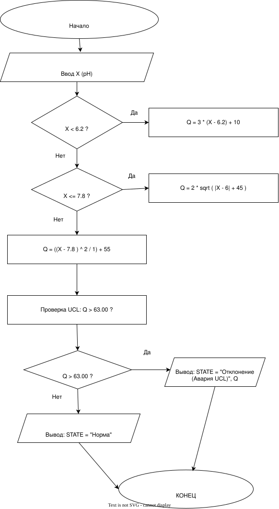

# Система мониторинга pH реакционной смеси

## Постановка задачи

Программа предназначена для мониторинга технологического процесса в химическом реакторе по параметру «pH реакционной смеси» (X). Программа преобразует измеряемые значения в нормированный показатель качества Q(X), проводит оперативный контроль состояния процесса и статистический анализ выборки.

### Входные данные:

*   Параметр X: pH реакционной смеси, измеряется в pH.
*   Диапазон X: от 3 до 11 pH.
*   Количество измерений в выборке: N = 50.

### Формула преобразования Q(X):

```text
Q(X) = {
    3*(X - 6.2) + 10          при X < 6.2
    2*√(|X - 7 + 1|) + 45     при 6.2 ≤ X ≤ 7.8
    ((X - 7.8)^2) / 1 + 55    при X > 7.8
}
```

 ### Ручной расчет (Примеры):

1. **X = 5.0** (меньше 6.2): 
   Q = 3*(5.0 - 6.2) + 10 = 3*(-1.2) + 10 = -3.6 + 10 = 6.40

2. **X = 7.0** (в диапазоне 6.2 - 7.8): 
   Q = 2*√(|7.0 - 7 + 1|) + 45 = 2*√(1) + 45 = 2 + 45 = 47.00

3. **X = 8.0** (больше 7.8): 
   Q = (8.0 - 7.8)^2 / 1 + 55 = (0.2)^2 + 55 = 0.04 + 55 = 55.04
   


### Оперативный контроль (UCL)

* Верхняя граница (UCL) контроля: **63.00**.
*   Контроль выполняется непосредственно при поступлении нового значения \(Q_i\).
*   Если значение \(Q_i > 63.00\), программа сигнализирует об аварийной ситуации (выводит состояние `"Превышение UCL!"`).
*   Если \(Q_i \le 63.00\), состояние оценивается как `"Норма"`.

### Статистический анализ

После генерации (или считывания) массива измерений (N=50) программа рассчитывает и выводит следующие показатели для накопленного массива \(Q\):
1.  **Среднее значение** (Mean).
2.  **Медиана** (Median).

### Пример работы программы (Контрольный пример)

В задании указан обязательный контрольный пример для проверки корректности формул:
*   Входные данные: `X = 7.64`
*   Ожидаемый результат: `Q = 47.56`

**Вывод программы в консоль:**

```text
--- Вариант 5. Мониторинг реактора ---

1. Контрольный пример:
   X = 7.64 -> Q = 47.5612 (Ожидается: 47.56)
   [OK] Тест пройден.

2. Генерация 50 измерений и расчет Q:
   №          | pH (X)     | Q(X)       | Статус (UCL=63)
   --------------------------------------------------------
   1          | 7.46       | 47.42      | Норма
   2          | 3.44       | 1.72       | Норма
   3          | 6.70       | 46.67      | Норма
   ...
   >> АВАРИЯ: Измерение #20 (X=10.74) дало Q=63.64 > 63.00

3. Статистический анализ:
   Среднее значение Q: 35.2645
   Медиана Q:          47.2494
